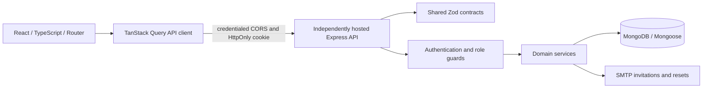

# Architecture and roadmap

## Requirements and decisions

The platform serves one tuition provider and four roles. Teacher accounts are supported, but this is not a multi-tenant SaaS: no tenant isolation is claimed. Public registration is disabled. Administrators invite users; initial admin creation is a local maintenance command. Email is the unique login identifier. Bcrypt work factor is 12, with a 72-byte ceiling and minimum 12-character passwords. Sessions last 12 hours by default with absolute server-side expiry.

Dates are stored as UTC instants and displayed in Asia/Colombo. One student can enroll in many classes and belongs to at most one batch per class initially. Parents can have many children and each child can have multiple parents. Relationship writes will require an administrator. An admin account can grant other admin accounts intentionally.

Pending product decisions before Phase 2: exact grading scale, institution branding, class schedule recurrence, parent verification procedure, data retention period, production hosting and SMTP provider. Before Phase 3: permitted answer review timing, late-work policy, and accommodations. Proposed quiz defaults: exact-match multiple-answer scoring, no negative marks, no partial credit, timer capped by scheduled close, immutable published question content after attempts begin.

## System boundaries



Frontend route protection improves navigation only. Express is the authority. Every session lookup verifies current user status, role, credential version, and expiration. Session identifiers and reset tokens are random 256-bit values; only their SHA-256 digests are stored. Password changes increment a credential version, making old sessions unusable even if deletion races with login. Reset tokens are consumed with one atomic update. Email links carry the token in a URL fragment; the UI removes it from the address bar after reading it.

All writes require an exact allowed Origin and a custom header. Credentialed CORS permits only the configured frontend origin. Production cookies are `__Host-` prefixed, Secure, HttpOnly and Path=/; SameSite defaults to Strict for same-site hosts and can be configured as None for unrelated HTTPS sites. Browser third-party-cookie restrictions still apply. Web and API deploy independently from this workspace without Docker; distributed rate limiting is required before horizontal scaling. See operations.md for environment and proxy configuration.

Services hold reusable business rules; controllers parse input and format responses. Mongoose performs persistence directly in this phase. Add repositories where complex queries warrant them rather than introducing pass-through wrappers. All async route failures flow through one error handler. Public DTOs explicitly select safe user fields.

## Role permission matrix

| Capability | Admin | Teacher | Student | Parent |
|---|---|---|---|---|
| Invite/manage accounts and relationships | Yes | No | No | No |
| Manage classes and assessments | All | Assigned classes | No | No |
| Take quizzes | No | No | Eligible self only | No |
| Read results | All | Assigned classes | Published own | Published linked child |
| Change own password / logout | Yes | Yes | Yes | Yes |

Phases 1–2 implement invitations/authentication and user/class management permissions with query-level ownership, enrollment and parent-relationship constraints. Admins enroll new students; teachers can move their enrolled students between batches and remove enrollments. Quiz and result permissions remain design contracts for later phases.

## Full target folder structure

```text
apps/
  api/
    src/
      app.ts, server.ts, config.ts
      db/models.ts
      lib/{errors,mail}.ts
      middleware/auth.ts
      modules/
        auth/service.ts
        users/                 [Phase 2 controller/service/repository]
        classes/               [Phase 2]
        batches/               [Phase 2]
        enrollments/           [Phase 2]
        relationships/         [Phase 2]
        quizzes/               [Phase 3]
        attempts/              [Phase 3]
        progress/              [Phase 4]
        reports/               [Phase 4]
      scripts/bootstrap.ts
    tests/auth.test.ts
  web/
    src/
      main.tsx, styles.css
      components/ui/button.tsx
      lib/{api,utils}.ts
      pages/app.tsx
      features/                [Phase 2–4 module-specific views/hooks]
packages/contracts/src/index.ts
docs/{architecture,database,api,operations}.md
```

Phase 2 controllers are in `modules/classes/routes.ts`, supported by `modules/classes/service.ts`, `modules/users/service.ts` and `lib/transaction.ts`. The frontend management screens are in `features/management.tsx`. `tests/management.test.ts` verifies isolation and transactional invariants. Future phase folders remain scope notes. Add Recharts alongside real analytics in Phase 4.

## Implementation phases and acceptance gates

1. **Foundation (this change):** workspace, schemas, shared contracts, auth, invitation/reset email, responsive light/dark authenticated shell, protected routes. Gate: TypeScript/build pass and real-database API tests covering authentication, role denial, tokens, cookies, expiry, input validation and rate limits.
2. **People and classes:** paginated user CRUD/deactivation, profile records, parent relationships, classes/batches, enrollments. Add service-level role/reference validation and ownership checks. Gate: negative cross-child/cross-class tests and actual CRUD UI validation; student data never leaks to unrelated parents.
3. **Quiz engine:** teacher builder, publishing and duplication, eligible quiz list, persistent timed attempts, autosave, navigation, submission and grading. Freeze quiz content after first attempt. Use MongoDB replica-set transactions and atomic sequence allocation for attempt limits; optimistic versioning for autosave and compare-and-set final submission. Gate: grading unit tests plus race/duplicate/expiry/enrollment tests, refresh and offline retry checks. Timeout finalization must run on the server even without a browser.
4. **Results and progress:** publication-aware student/parent views, child switcher, teacher analytics, Recharts trends and subject/topic summaries, downloadable reports. Compute aggregates from finalized attempts, define retake aggregation policy, distinguish unpublished from missing scores. Gate: linked-child isolation, publication filtering, aggregation fixtures and chart accessibility checks.
5. **Release:** cross-browser/mobile/accessibility checks, deployment hardening, distributed throttling if needed, database migration/index rollout, load tests, monitoring, backup restoration drill, retention policies and operational review. Gate: production-like end-to-end run and recovery test before claiming production readiness.

Each phase must update shared contracts, implementation, API specification, tests and operational notes together. Do not advance a phase with known failed verification.
