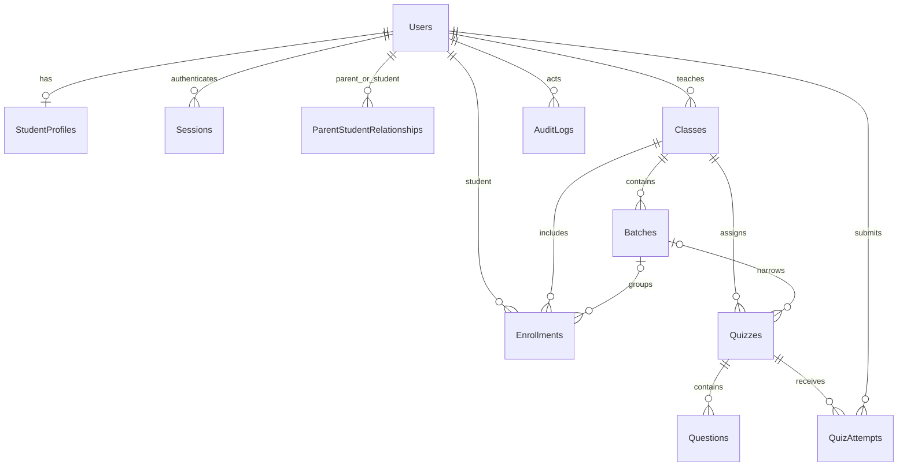

# Database design

Domain schemas have timestamps. Relationships are ObjectId references. MongoDB does not enforce foreign keys: Phase 2 services validate member roles, enabled status, ownership and batch/class consistency. Class-management schemas are implemented; quiz schemas remain the starting model for Phase 3.

| Collection | Main fields | Index/invariant |
|---|---|---|
| Users | name, email, role, status, passwordHash, credentialVersion, resetTokenHash/expiry | unique email; secrets excluded by default; invited/active/inactive |
| Sessions | tokenHash, user, credentialVersion, expiresAt | unique digest; TTL expiry; expiry also checked per request |
| StudentProfiles | user, studentNumber, grade, school | unique user and student number |
| ParentStudentRelationships | parent, student, linkedBy | unique parent/student pair |
| Classes | name, subject, grade, teacher, status | active/archived; teacher authorization required |
| Batches | name, class, schedule, timezone, status | unique class/name |
| Enrollments | student, class, optional batch, status | unique student/class; removed records retained |
| Quizzes | title, subject, class/batch, timing, duration, maxAttempts, grading/review settings, status | batch belongs to class; end after start; passing <= sum(question marks) |
| Questions | quiz, position, type, topic, options, correctOptionIds, marks | unique quiz/position; correct answers excluded by default |
| QuizAttempts | quiz, student, attemptNumber, deadline, answers, final result | unique student/quiz/attemptNumber; one in-progress attempt per student/quiz |
| AuditLogs | actor, action, target | append-only application writes; never store credentials/tokens |
| AdministrationLocks | singleton id, version | serializes transactional management invariants across API processes |

Results live inside finalized attempts so historical attempts are never overwritten by retakes. Total marks are derived from questions at publication and stored with the final attempt score. Published content must be frozen once used, or versioned before edits become available. Query projections must explicitly omit grading keys on all student payloads; `select:false` is defense in depth, not the entire control.

Phase 2 implements role-aware reference checks, user role/status and class enrollment indexes, and transactional management writes. A singleton administration document serializes changes to guard against concurrent last-admin removal and relationship/role/enrollment races. This is appropriate for a single-teacher workload; revisit lock granularity before scaling. Management transaction callbacks recheck the actor's active role. Phase 3 will add strict question validation, attempt snapshots/order, autosave versions, and transactional attempt allocation. Never rely on a schema index alone for attempt-limit enforcement.

Soft deletion uses status on users/classes/batches/enrollments and archival on quizzes. Users with historical attempts must not be hard-deleted by ordinary account management. Retention and anonymization require an explicit institution policy in Phase 5.
